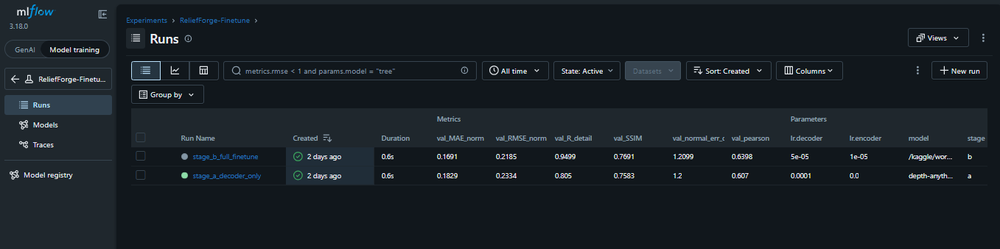
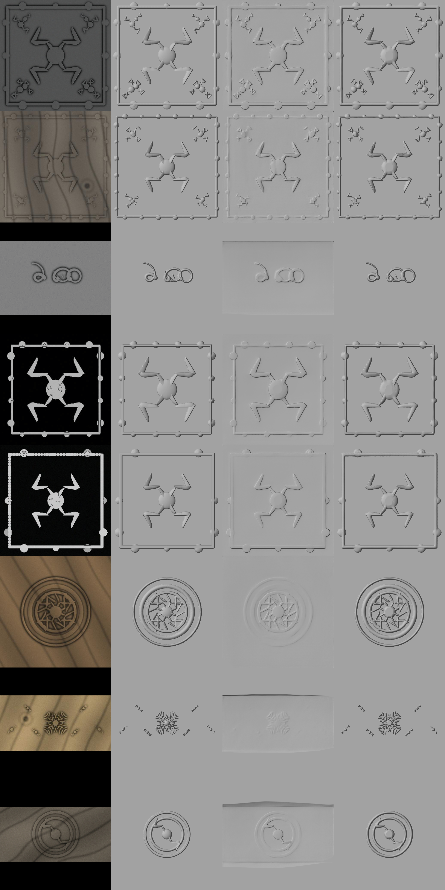
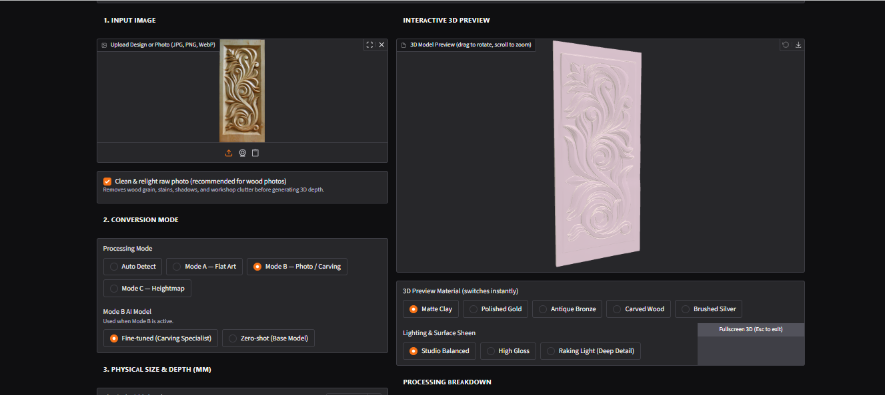
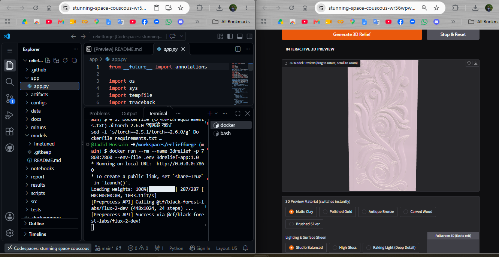

# ReliefForge — Fine-Tuned 2D Image to 2.5D/3D CNC Relief File Generation

Final project for the **Certification in Machine Learning and Deep Learning (SICIP, BRAC University)** — domain: *Other* (custom ML system for digital manufacturing).

## 1. Project overview

**Problem.** CNC carving of furniture panels, doors and ornaments needs a relief height file (a height field `Z = f(X, Y)` that a 3-axis router follows). Modelling it by hand in CAD is slow.

**System.** The user uploads a 2D design image (flat ornament, B/W line art, or a photo of a carved panel) plus physical parameters (width, relief depth, base thickness, tool diameter). A fine-tuned **Depth Anything V2 Small** (DINOv2 ViT-S, 24.8M params, Apache-2.0) predicts the relief height.

**Expected output.** A 16-bit height map (`relief_heightmap_16bit.tiff`), a **watertight** solid mesh in millimetres (`relief.stl/.obj/.3mf`), `relief_meta.json` (physical scale + validation report), and manufacturing warnings — downloadable from the web app. Height from one image is *relative and plausible*; "AI draft + human review" is the intended workflow.

## 2. Dataset

| | |
|---|---|
| **Primary (real)** | [KarimT/Relief-Depth](https://huggingface.co/datasets/KarimT/Relief-Depth) — 807 relief scenes from Sketchfab museum 3D models (British Museum, MET, …), each rendered under 5 lightings with **depth rendered from the real geometry**: 8,070 RGB–depth pairs, 768×768, 16-bit depth. Dataset splits respected: 689 train / 89 val / 84 test scenes. |
| **Auxiliary (synthetic)** | Our procedural generator (`src/synth/`): 1,500 ornamental scenes with exact height labels (families: floral, botanical, scroll, border, medallion, panel) rendered in 4 styles (wood/clay/flat/B&W). |
| **Why it fits** | Paired (image → relief height) data does not exist for this task anywhere else; Relief-Depth gives real relief geometry, the synthetic set anchors the height convention and covers flat/BW inputs. Training mixes ~65 % real + ~35 % synthetic. |
| **Licence** | Relief-Depth sources are mostly museum CC-BY-NC → fine for this course/research; **not** for a commercial product (documented in §11). |

**Fetch / build into `data/` (never committed; `data/` is git-ignored):**

```bash
python src/data_download.py --relief-depth --real-out data/relief_depth \
    --out data/relief_dataset --n-scenes 1500 --workers 4 --textures
```

Downloads and converts Relief-Depth (~11 GB), generates the synthetic set, and fetches ~10 CC0 albedo textures (ambientCG). Data exploration: `notebooks/exploration.ipynb`.

## 3. Setup

Python **3.10+** (tested on 3.12; Kaggle uses its preinstalled stack).

```bash
git clone https://github.com/<YOUR_USERNAME>/reliefforge.git
cd reliefforge
python -m venv .venv && .venv/Scripts/activate        # source .venv/bin/activate on Linux
pip install torch --index-url https://download.pytorch.org/whl/cpu
pip install -r requirements.txt
pytest tests/ -q        # 168 tests (downloads the zero-shot weights on first use)
```

## 4. Training (MLflow-tracked, two stages)

```bash
python src/train.py --config configs/stage_a.yaml --data data/relief_dataset --real-root data/relief_depth
python src/train.py --config configs/stage_b.yaml --data data/relief_dataset --real-root data/relief_depth \
    --stage-a-dir artifacts/train_a/export
```

Key hyperparameters: **Stage A** freezes the DINOv2 encoder, trains the DPT neck/head at LR 1e-4 (2,000 steps); **Stage B** trains all weights — encoder 1e-5, decoder 5e-5 (8,000 steps). Batch 8, AdamW (weight decay 1e-4), warmup 300 + cosine schedule, AMP fp16, grad-clip 1.0, EMA 0.999. Loss: median/MAD-normalized L1 + multi-scale gradient matching + a normal loss with physical `κ = depth_mm × px_per_mm × view_scale` (float32 outside autocast). Loss weights: `L = 1.0·L_h + 0.5·L_g + 0.1·L_n`. On Kaggle use `notebooks/kaggle/nb01→nb02→nb03` (GPU T4 ×2, one GPU used).

## 5. MLflow tracking

`mlruns/` **is committed** (required evidence; only weight binaries are git-ignored — regenerable via §4).

```bash
export MLFLOW_ALLOW_FILE_STORE=true        # mlflow ≥ 3.18 file-store opt-in
mlflow ui --backend-store-uri file:///$(pwd)/mlruns    # http://127.0.0.1:5000
```

- **Experiments/runs (≥ 2 required):** `ReliefForge-Finetune` — `stage_a_decoder_only`, `stage_b_full_finetune`; `ReliefForge-Eval` — `zeroshot_baseline`, `stage_a`, `stage_b` (5 runs).
- **Params:** full flattened config (LRs, steps, batch, loss weights, EMA, stage). **Metrics:** `train_loss/L_h/L_g/L_n`, `lr_encoder/decoder`, `images_per_s` (every 100 steps) and `val_MAE_norm`, `val_normal_err_deg`, `val_pearson`; eval runs log MAE/SSIM/normal-error/R_detail/Pearson per model and resolution. **Artifacts:** `history.csv`, eval CSVs, figures, model export.
- Transparency: on Kaggle the runs stored only tags (an mlflow 3.18 API change); the real numbers were re-logged locally with the original Kaggle run ids in the tags (`scripts/recover_mlflow_evidence.py`).

**MLflow screenshots**


*`screenshots/mlflow_runs.png` — the MLflow experiments page (ReliefForge-Finetune + ReliefForge-Eval).*


*`screenshots/training_result.png` — run detail with logged metrics.*

## 6. Evaluation

```bash
# primary: real Relief-Depth held-out test split
python src/evaluate.py --data data/relief_dataset --real data/relief_depth --zero-shot
python src/evaluate.py --data data/relief_dataset --real data/relief_depth --model artifacts/train_b/export --label stage_b
# resolution study + synthetic exact-label test
python src/evaluate.py --data data/relief_dataset --model artifacts/train_b/export --sizes 518 756 1036
```

Results on the real test split (168 pairs, after the production normalization):

| Model | S | MAE_norm | RMSE_norm | SSIM | normal err (°) | R_detail | Pearson |
|---|---|---|---|---|---|---|---|
| Zero-shot DAv2-S | 518 | 0.2417 | 0.2958 | 0.5318 | 1.27 | 0.594 | 0.4843 |
| Fine-tuned Stage A | 518 | 0.1829 | 0.2334 | 0.7583 | 1.20 | 0.805 | 0.6070 |
| **Stage B (EMA)** | **518** | **0.1691** | **0.2185** | **0.7691** | **1.21** | **0.9499** | **0.6398** |
| Stage B | 756 | 0.1685 | 0.2179 | 0.7932 | 0.87 | 0.9372 | 0.6446 |
| Stage B | 1036 | 0.1717 | 0.2220 | 0.8044 | 0.70 | 0.8994 | 0.6363 |

**Interpretation.** The zero-shot model does not know the project's height convention (background = base plane, ornaments raised) and confuses shading with height. Fine-tuning fixes exactly that: normalized MAE −30 % (0.242 → 0.169), SSIM 0.53 → 0.77, detail retention 0.59 → 0.95. In CNC terms (300 mm panel, 8 mm depth): ≈ 1.35 mm average height error vs ≈ 1.93 mm zero-shot. Plots: `results/comparison_chart.png`, `results/resolution_study.png`, `results/qualitative.png`.

## 7. Course techniques used (and where)

Mapped to the course outline (Certification in ML and Deep Learning, SICIP Batch 01):

| Course topic | Where used |
|---|---|
| Neural networks & deep learning (backpropagation, activation functions, gradient-descent optimizers) | End-to-end fine-tuning by backpropagation, AdamW + warmup/cosine schedule, GELU/ReLU activations (`src/ml/trainer.py`) |
| CNNs (convolutions, pooling, ResNet-style residual blocks) | DPT neck/head fully convolutional with residual layers; ViT patch embedding is a strided convolution (`src/reliefkit/model.py`) |
| Transformers (self-attention, pretrained encoders) | DINOv2 ViT-S Transformer encoder as the backbone, fine-tuned for relief height (`src/ml/trainer.py`) |
| Transfer learning & fine-tuning; domain adaptation | Two-stage fine-tuning of pretrained Depth Anything V2; hybrid real + synthetic data (`src/ml/trainer.py`, `src/ml/dataset.py`, `src/ml/realdata.py`) |
| Regularization techniques | Weight decay 1e-4, grad-clip 1.0, weight EMA 0.999, data augmentation (`src/ml/trainer.py`, `src/ml/ema.py`) |
| Hyperparameter tuning | Stage A vs B LR settings as separate MLflow runs; resolution study S ∈ {518, 756, 1036} (`configs/`, `src/evaluate.py`) |
| Scalability & deployment: MLflow, Docker, model serving | `src/ml/tracking.py`; `Dockerfile`, `app/app.py` |
| Model evaluation & error analysis | MAE/RMSE, SSIM, normal angular error, R_detail, Pearson + per relief-type/lighting/resolution breakdowns (`src/ml/metrics.py`, `src/ml/evaluate.py`) |
| Ethical considerations (data provenance, responsible use) | Licence audit of Relief-Depth (CC-BY-NC), commercial-use restriction documented (§11) |

Not applicable to this task (not forced in): RNN/LSTM (no sequential data), GAN/VAE and reinforcement learning (procedural generation + regression used instead), SHAP/LIME (dense prediction; per-relief-type error analysis used instead).

## 8. Docker prediction app

```bash
docker build -t reliefforge-app:1.0 .
docker run -p 7860:7860 reliefforge-app:1.0                        # zero-shot weights baked in
docker run -p 7860:7860 -v /path/to/export:/models/finetuned reliefforge-app:1.0   # + fine-tuned
```

Open **http://localhost:7860**, upload a design image (e.g. an ornament photo or flat ornament PNG), set width/depth/base/tool, press **Generate relief** — the app shows the shaded height, a 3D preview and a downloadable ZIP (STL/OBJ/3MF + 16-bit TIFF + sidecar). Local run without Docker: `python app/app.py`. CLI: `python src/predict.py design.png out/ --mode B --width 300 --depth 8 --tool 1.0`.

**Demo screenshots**


*`screenshots/demo_output.png` — prediction UI: uploaded design → shaded relief, 3D preview, generated files.*


*`screenshots/docker_app_running.png` — the Docker-served app working end-to-end.*

## 9. Repository structure

```
README.md  final_report.md  requirements.txt  .gitignore  .gitattributes  Dockerfile
configs/          config.yaml, stage_a.yaml, stage_b.yaml
src/              data_download.py, generate_dataset.py, train.py, evaluate.py, predict.py
                  reliefkit/ (inference library)  synth/ (generator)  ml/ (training/eval)
app/app.py        Gradio prediction UI (served with Docker)
notebooks/        exploration.ipynb, kaggle/{nb01_generate_dataset, nb02_train, nb03_evaluate}
tests/            168 pytest tests
mlruns/           MLflow evidence (committed, not ignored)
screenshots/      mlflow_runs.png, training_result.png, demo_output.png, docker_app_running.png
results/          evaluation CSVs, comparison/resolution charts, qualitative figure
report/           SICIP_NAME_ID.docx → exported as SICIP_NAME_ID.pdf
models/ data/ artifacts/   empty in git (data & weights never committed)
```

## 10. Reproduce from a fresh clone

1. Install (§3) → 2. Fetch/build data into `data/` (§2) → 3. Train Stage A then B (§4) → 4. Review MLflow runs (§5) → 5. Evaluate (§6) → 6. Build & run the Docker app (§8). Compute: dataset ~30 min CPU, training ~2–3 h on one Kaggle T4, evaluation ~20 min GPU.

## 11. Limitations

- Single-image height is **relative, not measured**; human review + sliders (depth, invert, smoothing, transition width) stay in the loop.
- Domain: ornamental relief carving. Faces, figures, animals, lettering and general photos are out-of-distribution; strongly perspective phone photos are not rectified.
- No undercuts (height field), no G-code/toolpaths, no STEP or proprietary CAM formats; no physical carving validation was performed.
- CC-BY-NC training data → the fine-tuned weights are for course/research use; a commercial product must retrain (the synthetic-only pipeline in this repo can regenerate licence-clean weights).
- CPU inference defaults to 518 px (~2 s/image); higher sizes are slower.

**Future improvements:** the client workshop's own hand-made reliefs (`src/ml/clientdata.py` importer already exists — also makes the weights commercially clean), more real data by rendering additional CC0 models, a brush-based height editor, tile-based inference for very large panels, a resolution fine-tune (Stage C) and CAM/toolpath integration.

## 12. Final report

`final_report.md` (source) and the completed faculty template `report/SICIP_NAME_ID.docx`, exported as **`report/SICIP_NAME_ID.pdf`** for submission.
